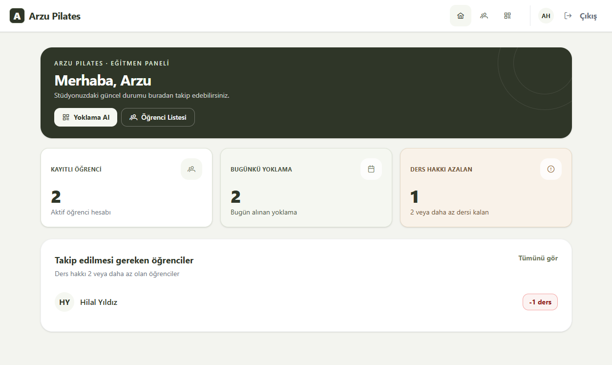
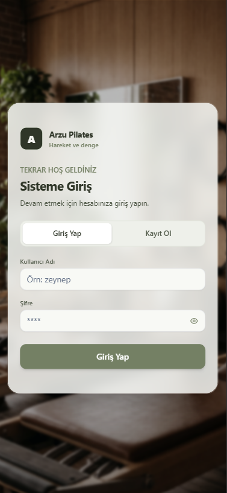
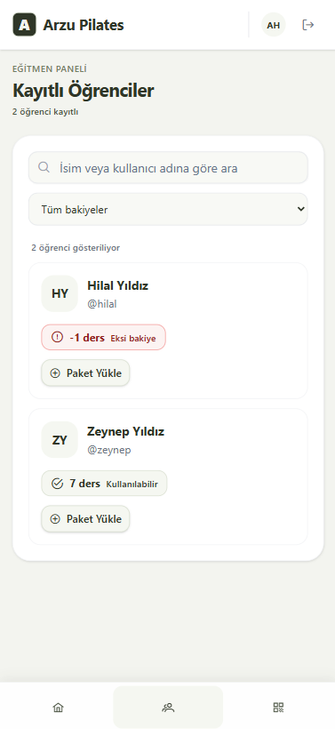
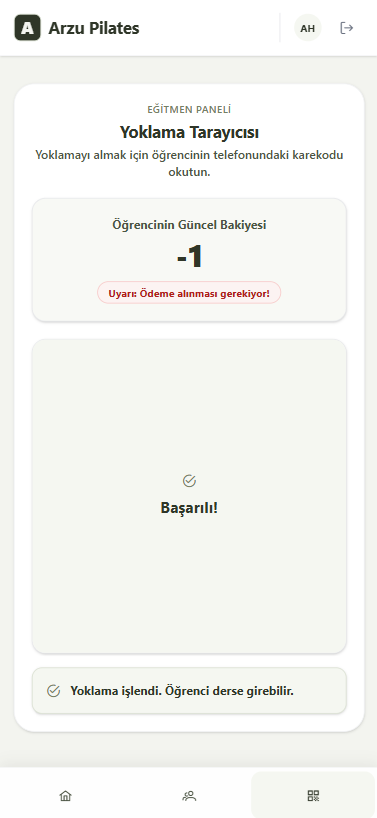
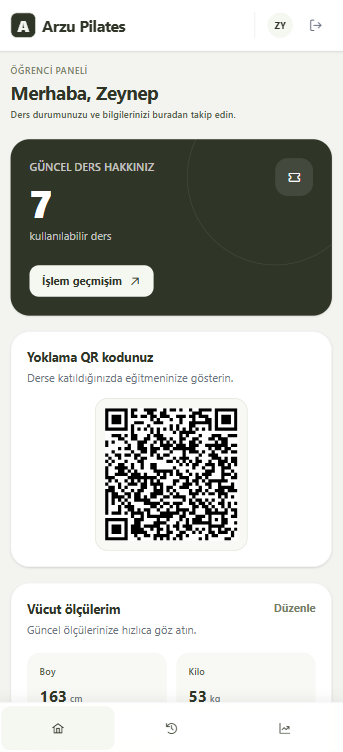
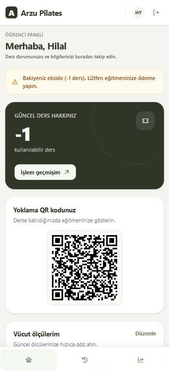
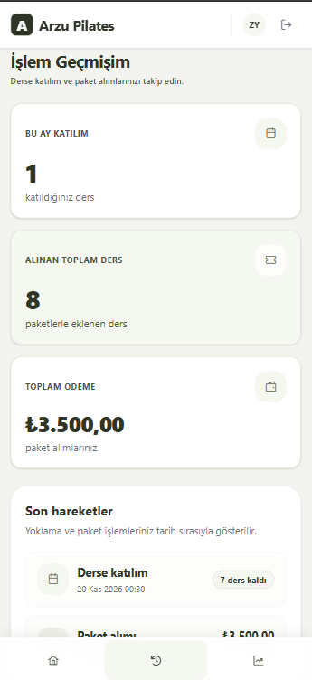

# Arzu Pilates — QR Yoklama ve Öğrenci Takip Sistemi

Pilates stüdyoları için geliştirilmiş; QR kod ile yoklama alma, ders paketi/bakiye takibi, vücut ölçüsü kaydı ve anlık bildirim özellikleri sunan full-stack web uygulaması.

## Özellikler

### Eğitmen Paneli
* **Genel Bakış:** Kayıtlı öğrenci sayısı, günlük yoklama adedi ve ders hakkı azalan/eksiye düşen öğrencilerin takibi.
* **QR Yoklama Tarayıcısı:** Öğrencinin ekranındaki QR kodu kamera ile okutarak anında yoklama alma ve bakiye düşme.
* **Öğrenci ve Paket Yönetimi:** İsim/kullanıcı adına veya bakiye durumuna göre filtreleme, öğrencilere yeni ders paketi tanımlama.
* **Anlık Bildirimler:** Yeni öğrenci kaydı veya yoklama işlemlerinde SignalR üzerinden sayfa yenilemeden canlı güncelleme.

### Öğrenci Paneli
* **Dinamik QR Kod:** Derse girişte eğitmene gösterilmek üzere otomatik yenilenen yoklama QR kodu.
* **Bakiye ve Uyarılar:** Güncel ders hakkı görüntüleme; ders hakkı bittiğinde veya eksiye düştüğünde anlık bildirim ve profil uyarısı.
* **İşlem Geçmişi:** Derse katılım kayıtları, paket alımları ve toplam ödeme özeti.
* **Vücut Ölçüleri:** Boy, kilo ve bel gibi güncel ölçülerin kaydı ve düzenlenmesi.

---

## Ekran Görüntüleri

### Eğitmen Paneli (Masaüstü)


### Giriş ve Eğitmen Ekranları (Mobil)
| Giriş Ekranı | Kayıtlı Öğrenciler | QR Yoklama Tarayıcısı |
| :---: | :---: | :---: |
|  |  |  |

### Öğrenci Paneli (Mobil)
| Öğrenci Profili & QR | Eksi Bakiye Uyarısı | İşlem Geçmişi |
| :---: | :---: | :---: |
|  |  |  |

---

## Kullanılan Teknolojiler

**Backend**
* ASP.NET Core Web API
* Entity Framework Core & PostgreSQL
* SignalR (Gerçek zamanlı iletişim)
* JWT Authentication & Role-Based Authorization (RBAC)
* BCrypt.Net (Şifre hashleme)

**Frontend**
* Vue 3 (Composition API) & TypeScript
* Pinia & Vue Router
* Tailwind CSS & PrimeVue
* `@microsoft/signalr`
* `qrcode.vue` & `vue-qrcode-reader`

---

## Proje Yapısı

```text
arzu_pilates/
├── api/                     # ASP.NET Core Web API (Backend)
│   ├── Controllers/         # API endpoint'leri
│   ├── Data/                # DbContext ve veritabanı yapılandırması
│   ├── DTOs/                # Veri transfer nesneleri
│   ├── Entities/            # Veritabanı modelleri
│   ├── Hubs/                # SignalR gerçek zamanlı bildirim hub'ları
│   ├── Migrations/          # EF Core veritabanı migration'ları
│   └── Program.cs           # Uygulama giriş noktası ve servis ayarları
│
├── client/                  # Vue 3 + TypeScript (Frontend)
│   └── src/
│       ├── assets/          # Görseller ve statik dosyalar
│       ├── components/      # Tekrar kullanılabilir arayüz bileşenleri
│       ├── composables/     # Paylaşılan Vue composable fonksiyonları
│       ├── router/          # Sayfa yönlendirme ve yetki kontrolleri
│       ├── services/        # API ve SignalR servis katmanı
│       ├── stores/          # Pinia durum yönetimi (state management)
│       ├── types/           # TypeScript arayüz ve tip tanımları
│       ├── utils/           # Yardımcı fonksiyonlar (QR üretimi vb.)
│       ├── views/           # Uygulama sayfaları
│       ├── App.vue
│       └── main.ts
│
└── docs/
    └── screenshots/         # README ekran görüntüleri
```

---

## Yerel Kurulum

### Gereksinimler
- .NET SDK
- Node.js (v18+)
- PostgreSQL

### 1. Backend Kurulumu (`api`)
1. `api` klasörüne geçin ve `appsettings.Development.json` dosyasını kendi yerel PostgreSQL ve JWT ayarlarınızla oluşturun:
   ```json
   {
     "ConnectionStrings": {
       "DefaultConnection": "Host=localhost;Port=5432;Database=arzu_pilates;Username=postgres;Password=SIFRENIZ"
     },
     "Jwt": {
       "Key": "EN_AZ_32_KARAKTERLIK_GIZLI_ANAHTAR"
     }
   }
   ```
2. Veritabanı tablolarını oluşturun ve API'yi başlatın:
   ```bash
   cd api
   dotnet ef database update
   dotnet run
   ```

### 2. Frontend Kurulumu (`client`)
1. Bağımlılıkları yükleyin ve geliştirme sunucusunu başlatın:
   ```bash
   cd client
   npm install
   npm run dev
   ```
2. Tarayıcıdan `http://localhost:5173` adresine gidin.

