# Arzu Pilates — Stüdyo Yönetim ve QR Yoklama Sistemi

Pilates stüdyoları için geliştirilmiş; QR kod ile yoklama alma, haftalık grup ders programı yönetimi, ders paketi/bakiye takibi, vücut ölçüsü kaydı ve anlık bildirim özellikleri sunan **mobil uyumlu (responsive)** full-stack PWA (Progressive Web App) uygulaması.

## Özellikler

### Eğitmen Paneli
- **Genel Bakış:** Kayıtlı öğrenci sayısı, bugünkü yoklama adedi ve ders hakkı azalan veya eksiye düşen öğrencilerin anlık özeti.
- **Haftalık Ders Programı:** Gün ve saat bazlı ders kartları oluşturma (1–4 kişilik esnek grup kapasitesi), gün filtreleme ve hem masaüstü hem mobil dokunmatik destekli sürükle-bırak / dokun-ata ile öğrenci yerleştirme.
- **QR Yoklama Tarayıcısı:** Öğrencinin ekranındaki QR kodu kamera ile okutarak anında yoklama alma, bakiye düşme ve eksi bakiyede ödeme uyarısı alma.
- **Öğrenci, Paket ve Manuel İşlem Yönetimi:** İsim/kullanıcı adı ve bakiye durumuna göre filtreleme, ders paketi tanımlama, sebep ve isteğe bağlı notla manuel ders düşme (son dakika iptali / QR okutulmadan manuel yoklama), tek seferlik geçici şifre sıfırlama ve öğrenci kaldırma.
- **Anlık Bildirimler:** Yeni öğrenci kaydı ve yoklama işlemlerinde SignalR üzerinden sayfa yenilemeden canlı güncelleme.

### Öğrenci Paneli
- **Dinamik QR Kod:** Derse girişte eğitmene gösterilmek üzere otomatik yenilenen yoklama QR kodu.
- **Bakiye ve Uyarılar:** Güncel ders hakkı takibi; ders hakkı bittiğinde veya eksiye düştüğünde anlık bildirim ve profil uyarısı.
- **Haftalık Ders Günlerim:** Eğitmenin ders programında atadığı haftalık gün ve saatlerin ana sayfada doğrudan görüntülenmesi.
- **İşlem Geçmişi:** QR yoklama kayıtları, notlu manuel ders düşümleri, paket yüklemeleri ve toplam ödeme özeti.
- **Vücut Ölçüleri:** Boy, kilo ve bel gibi güncel ölçülerin doğrulamalı kaydı ve düzenlenmesi.

### Hesap Güvenliği ve Mobil Deneyim
- **Mobil Uyumlu (Responsive) Tasarım:** Telefon, tablet ve masaüstü ekranlara göre uyarlanan arayüz; mobil cihazlarda tek elle kullanıma uygun alt gezinme çubuğu (bottom navigation) ve dokunmatik dostu etkileşimler.
- **PWA Desteği:** Mobil cihazlarda ana ekrana eklenebilen, iOS safe-area uyumlu tam ekran uygulama deneyimi.
- **Hesap Ayarları:** Ad, soyad, boşluk içermeyen kullanıcı adı ve şifre güncelleme.
- **Zorunlu Şifre Değişimi:** Eğitmen tarafından geçici şifre tanımlanan hesapların ilk girişte yeni şifre belirlemeye yönlendirilmesi.

---

## Ekran Görüntüleri

### Eğitmen Paneli (Masaüstü)
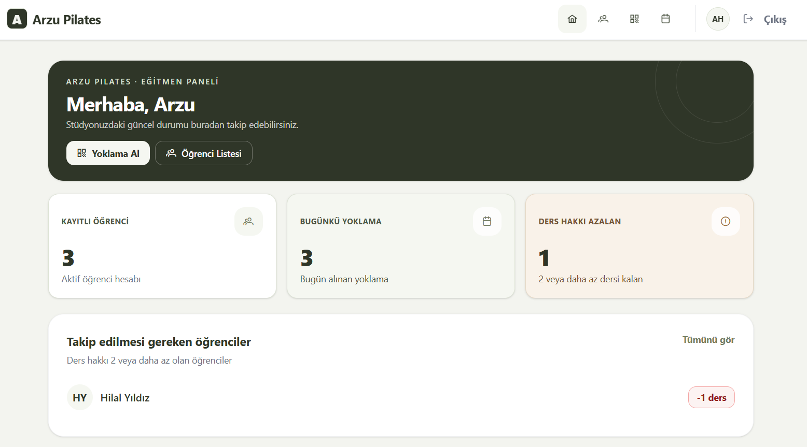

### Öğrenci Paneli (Masaüstü)
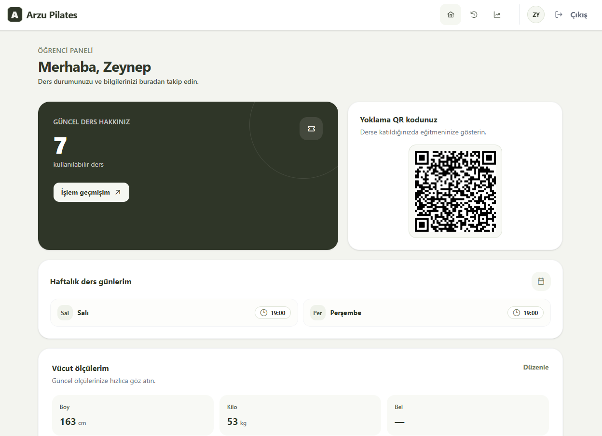

### Eğitmen Ekranları (Mobil)
| Kayıtlı Öğrenciler | Manuel Ders Düşme | Haftalık Ders Programı | QR Yoklama Tarayıcısı |
| :---: | :---: | :---: | :---: |
| 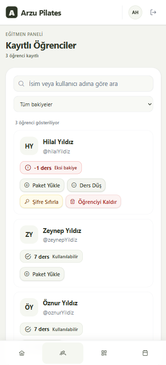 | 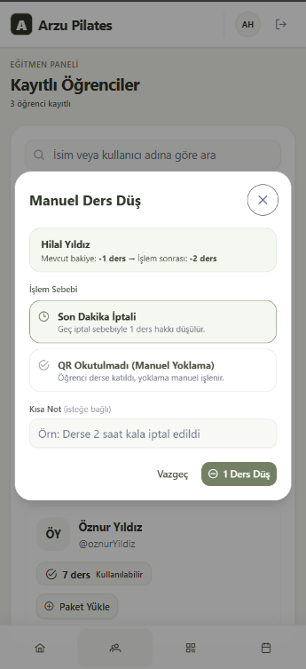 | 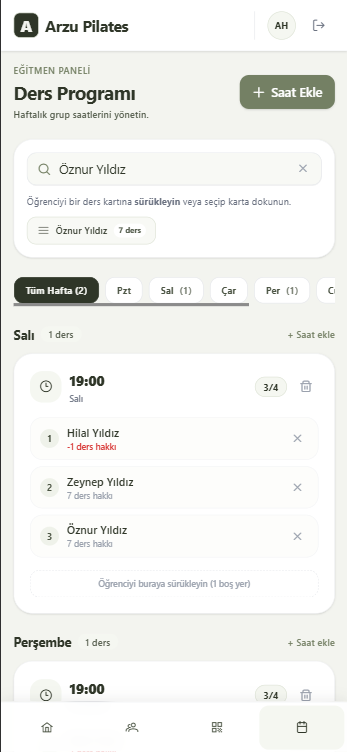 | 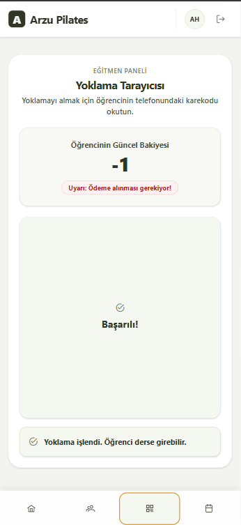 |

### Giriş, Öğrenci ve Hesap Ekranları (Mobil)
| Giriş Ekranı | Öğrenci Paneli & Bakiye Uyarısı | İşlem Geçmişi | Hesap Bilgilerim |
| :---: | :---: | :---: | :---: |
| 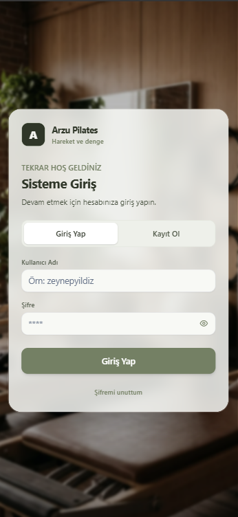 | 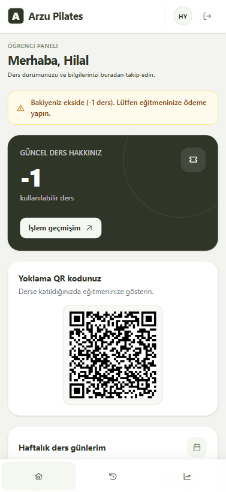 | 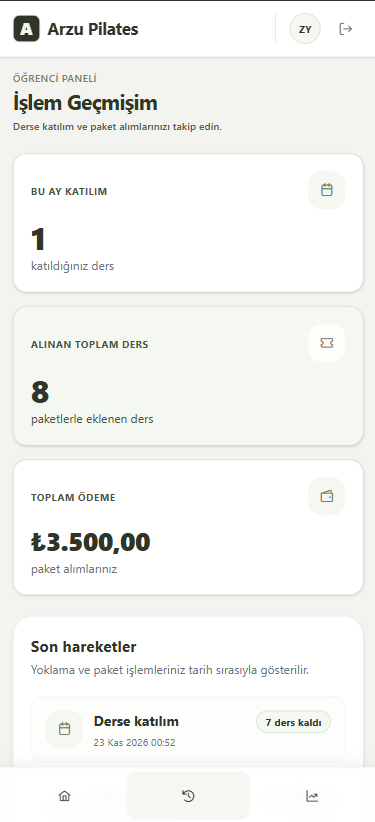 | 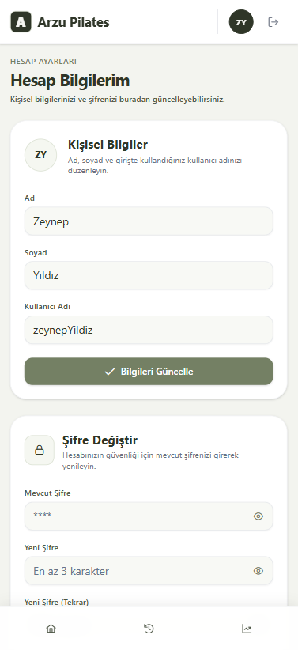 |

### PWA Ana Ekran Görünümü (iOS)
Uygulama, tarayıcı üzerinden **Ana Ekrana Ekle** seçeneğiyle özel ikonuyla mobil cihazlara kurulabilir ve tam ekran çalışır.

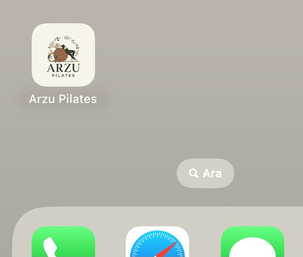

---

## Kullanılan Teknolojiler

**Backend**
- ASP.NET Core Web API
- Entity Framework Core & PostgreSQL
- SignalR (Gerçek zamanlı iletişim)
- JWT Authentication & Role-Based Authorization (RBAC)
- BCrypt.Net (Şifre hashleme)

**Frontend**
- Vue 3 (Composition API) & TypeScript
- Pinia & Vue Router
- Tailwind CSS & PrimeVue
- Vite & `vite-plugin-pwa` (PWA desteği)
- Axios & `@microsoft/signalr`
- `qrcode.vue` & `vue-qrcode-reader`

---

## Proje Yapısı

```text
arzu_pilates/
├── api/                     # ASP.NET Core Web API (Backend)
│   ├── Controllers/         # API endpoint'leri
│   ├── Data/                # DbContext ve veritabanı yapılandırması
│   ├── DTOs/                # Veri transfer nesneleri
│   ├── Entities/            # Veritabanı modelleri
│   ├── Hubs/                # SignalR gerçek zamanlı bildirim hub'ları
│   ├── Migrations/          # EF Core veritabanı migration'ları
│   └── Program.cs           # Uygulama giriş noktası ve servis ayarları
│
├── client/                  # Vue 3 + TypeScript (Frontend)
│   └── src/
│       ├── assets/          # Görseller ve statik dosyalar
│       ├── components/      # Tekrar kullanılabilir arayüz bileşenleri
│       ├── composables/     # Paylaşılan Vue composable fonksiyonları
│       ├── router/          # Sayfa yönlendirme ve yetki kontrolleri
│       ├── services/        # API ve SignalR servis katmanı
│       ├── stores/          # Pinia durum yönetimi (state management)
│       ├── types/           # TypeScript arayüz ve tip tanımları
│       ├── utils/           # Yardımcı fonksiyonlar (QR üretimi vb.)
│       ├── views/           # Uygulama sayfaları
│       ├── App.vue
│       └── main.ts
│
└── docs/
    └── screenshots/         # README ekran görüntüleri
```

---

## Yerel Kurulum

### Gereksinimler
- .NET SDK
- Node.js (v18+)
- PostgreSQL

### 1. Backend Kurulumu (`api`)
1. `api` klasörüne geçin ve `appsettings.Development.json` dosyasını kendi yerel PostgreSQL ve JWT ayarlarınızla oluşturun:
   ```json
   {
     "ConnectionStrings": {
       "DefaultConnection": "Host=localhost;Port=5432;Database=arzu_pilates;Username=postgres;Password=SIFRENIZ"
     },
     "Jwt": {
       "Key": "EN_AZ_32_KARAKTERLIK_GIZLI_ANAHTAR"
     }
   }
   ```
2. Veritabanı tablolarını oluşturun ve API'yi başlatın:
   ```bash
   cd api
   dotnet ef database update
   dotnet run
   ```

### 2. Frontend Kurulumu (`client`)
1. Bağımlılıkları yükleyin ve geliştirme sunucusunu başlatın:
   ```bash
   cd client
   npm install
   npm run dev
   ```
2. Tarayıcıdan `http://localhost:5173` adresine gidin.